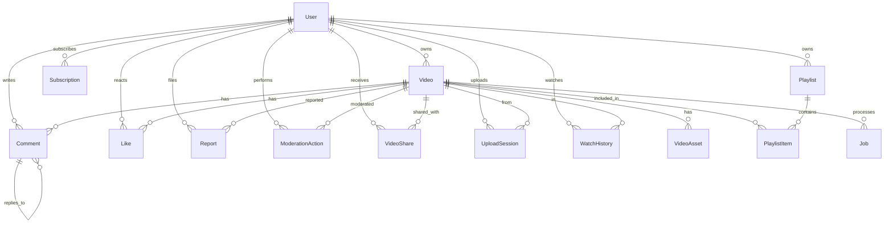

# Схема базы данных

14 таблиц, PostgreSQL. Первичные ключи — UUID строкой; `created_at`/`updated_at`
с таймзоной (`TIMESTAMPTZ`). Миграции — Alembic (`backend/alembic/versions`).

## Связи

## Таблицы

| Таблица | Ключевые поля |
|---------|---------------|
| `users` | username (unique), email (unique), password_hash, role (`user/moderator/admin`), avatar_url, cover_url, description, is_active |
| `videos` | owner_id → users, title, description, visibility (`public/private/unlisted/hidden`), status (`uploading/processing/ready/failed`), views, duration_seconds, tags (JSONB), custom_poster_url |
| `video_assets` | video_id → videos, quality (`360p/720p/1080p/poster`), object_key (S3), content_type, size_bytes |
| `upload_sessions` | user_id, video_id (nullable), filename, object_key, size_bytes, content_type, completed |
| `jobs` | type (`transcode`), status (`pending/running/done/failed`), payload (JSONB: video_id, object_key), attempts, error, locked_by, locked_at |
| `video_shares` | video_id, user_id — доступ к приватному видео; unique (video_id, user_id) |
| `comments` | video_id, author_id, parent_id (ответы), body |
| `likes` | video_id, user_id, is_like (true = лайк, false = дизлайк); unique (video_id, user_id) |
| `subscriptions` | subscriber_id, channel_id; unique (subscriber_id, channel_id) |
| `watch_history` | user_id, video_id, progress_seconds, last_watched_at; unique (user_id, video_id) |
| `playlists` | owner_id, title, description, visibility |
| `playlist_items` | playlist_id, video_id, position; unique (playlist_id, video_id) |
| `reports` | video_id, reporter_id, reason, status (`open/resolved/dismissed`); unique (video_id, reporter_id) |
| `moderation_actions` | video_id, moderator_id, action (`hide/restore`), reason |

## Ограничения и индексы

- Уникальные: username, email; `(video_id, user_id)` для likes, shares, reports;
  `(subscriber_id, channel_id)`; `(playlist_id, video_id)`;
  `(user_id, video_id)` для истории.
- Индекс `ix_watch_history_user_watched (user_id, last_watched_at)` для истории.
- Каскадные удаления: удаление пользователя/видео чистит зависимые строки
  (`ON DELETE CASCADE`); `upload_sessions.video_id` — `SET NULL`.
- Поиск по названию — `ILIKE` с экранированием `%`/`_`; отдельного tsvector-индекса
  нет.

## Перечисления

| Enum | Значения |
|------|----------|
| Role | user, moderator, admin |
| Visibility | public, private, unlisted, hidden |
| VideoStatus | uploading, processing, ready, failed |
| JobStatus | pending, running, done, failed |
| JobType | transcode |
